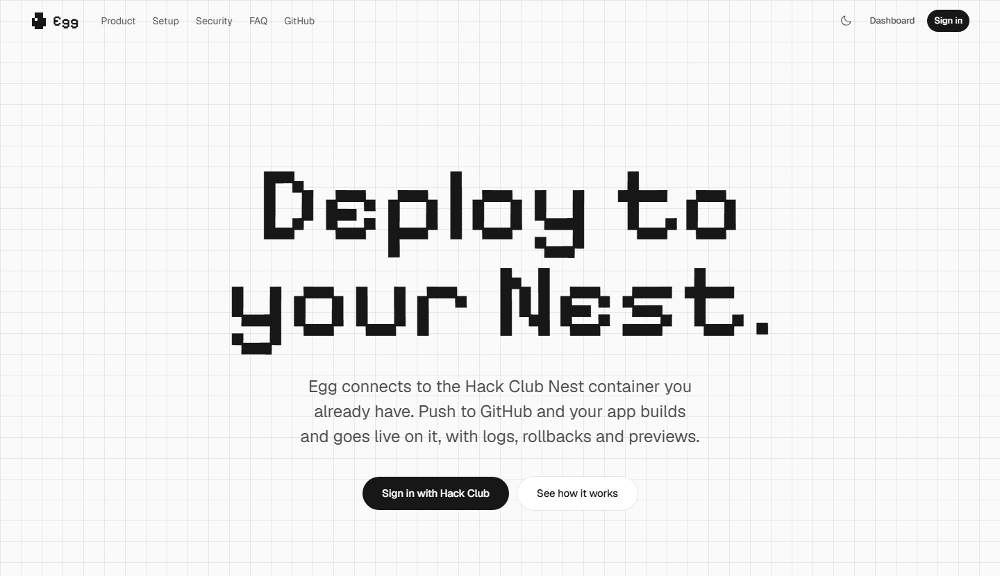
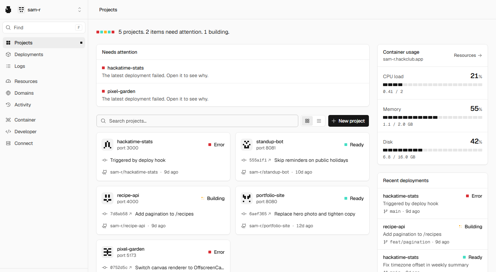
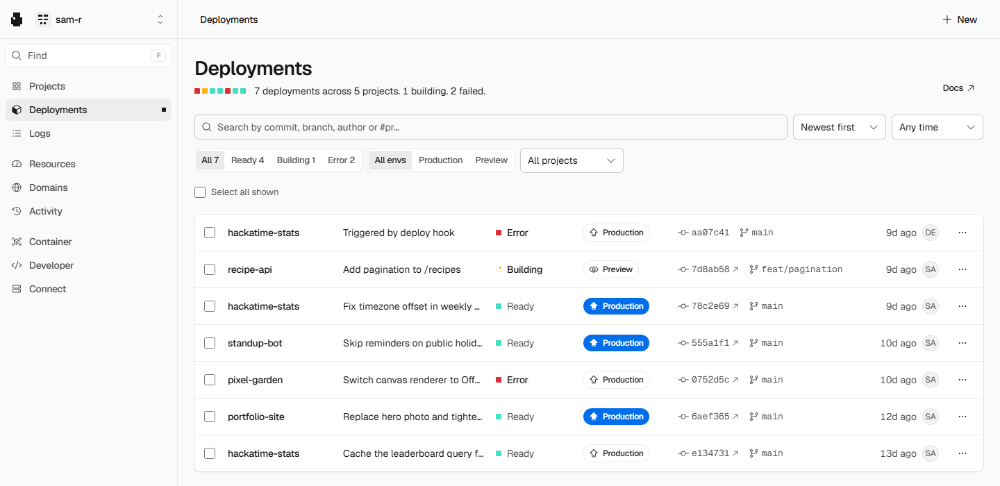
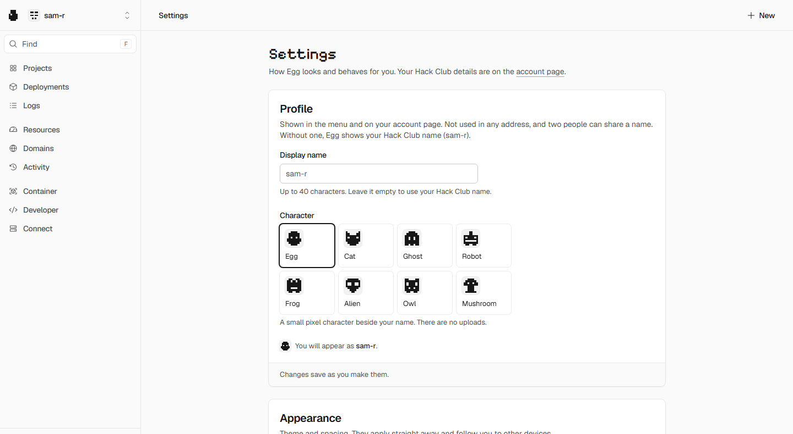

# Egg

A Vercel-style dashboard for deploying projects to [Hack Club Nest](https://guides.hackclub.app) servers. Push to GitHub and Egg builds your app and puts it live on your own Nest container, with logs, rollbacks and previews.

Egg is made by a Hack Club member. It is not an official Hack Club product, and the Nest team does not run it.



**Status:** working. The dashboard, deploy pipeline, GitHub integration, uptime monitor and analytics are built. The roadmap below lists what is not.

## What it looks like

| | |
| --- | --- |
|  |  |
| **Projects.** What needs attention, container load, and the latest deployments. | **Deployments.** Search and filter by status, environment and project. |



**Settings.** Built-in themes, a custom theme editor and VS Code theme import.

## What it does

- Sign in with Hack Club Auth, or with a local password when you run your own copy
- Connect one or more Nest servers with a dedicated SSH key, added in the Nest dashboard
- Import GitHub repositories; deploy on push, from a deploy hook, or by hand
- Builds run on your own container under a memory and CPU cap. If you prefer, GitHub Actions can build and hand a finished release to Egg with a scoped build credential
- Branch previews, health-checked deploys with automatic revert, and rollback to the last five releases
- Pull-request previews: a same-repository pull request links to its preview, gets one updated comment, and is cleaned up when it closes (forks are never built)
- Build and runtime logs (runtime logs are searchable), environment variables, custom domains, and a restart without redeploying
- Scheduled jobs: cron-style commands run as systemd timers on the container
- Uptime checks and usage history: the worker checks each live project and samples server load, memory and disk every 5 minutes (`MONITOR_INTERVAL_MS`, 0 turns it off), and alerts the project's Discord or Slack webhook when an app stops answering and when it recovers
- Per-project memory and CPU history (systemd accounting for that service only)
- Page-view analytics: a small cookie-free script the owner adds to their site, with views, visitors, top pages, referrers, speed and errors, custom events, locations and a live view. No IP addresses are stored; 90 days of history
- A public status page per project, and a public status page for Nest and Egg themselves
- A file manager and terminal for each project, an Activity page, and an account page with signed-in browsers and account deletion
- A guided first-project tour for new users
- A REST API (v1), an SDK and a command-line tool
- Themes: several built in, a custom theme editor and VS Code theme import

## Run it yourself

You can run the whole app privately on your own computer, with no Hack Club account. Set `LOCAL_MODE=1` and sign in with a local password that you set on your first visit. It can also run on your own server with Docker Compose and Caddy. Apps deploy to a Hack Club Nest container; a server you own over SSH is written for but not tested.

```bash
cd web
pnpm install
pnpm run setup   # creates .env.local with random secrets
pnpm dev         # http://localhost:3000, deployment worker included
```

- [docs/selfhost/README.md](docs/selfhost/README.md): the step-by-step guide, including Compose, backup and upgrade.
- [docs/selfhost/customising.md](docs/selfhost/customising.md): the name, colours, ports and build memory.
- [docs/design/self-host-gaps.md](docs/design/self-host-gaps.md): what a non-Hack-Club setup cannot do yet.

## Not built yet

- Team access screens. The API has project members and invitations (viewer and developer roles), but the dashboard has no screen for them yet
- Request counts and latency (analytics counts page views reported by the script, not server requests)
- Alert channels other than a Discord or Slack webhook, and per-project disk use

## Start here (for contributors)

1. [docs/decisions.md](docs/decisions.md): what has been decided, and why.
2. [docs/nest-research.md](docs/nest-research.md): how Nest works (SSH, the bastion, containers, networking, acceptable use), and what is still unverified.
3. [docs/planning/02-decided-feature-scope.md](docs/planning/02-decided-feature-scope.md): the Version 1 scope.
4. [docs/backend-setup.md](docs/backend-setup.md): backend setup, security notes and the API.

The other planning files are the research and history behind those decisions.

## Code

The web app is in [web/](web/). Its README covers the stack, design rules, and how to run it.

## Not in this repo

The raw Vercel documentation captures and the full feature catalogs (about 17 MB) stay in the planning vault. Add them here if they're needed.
